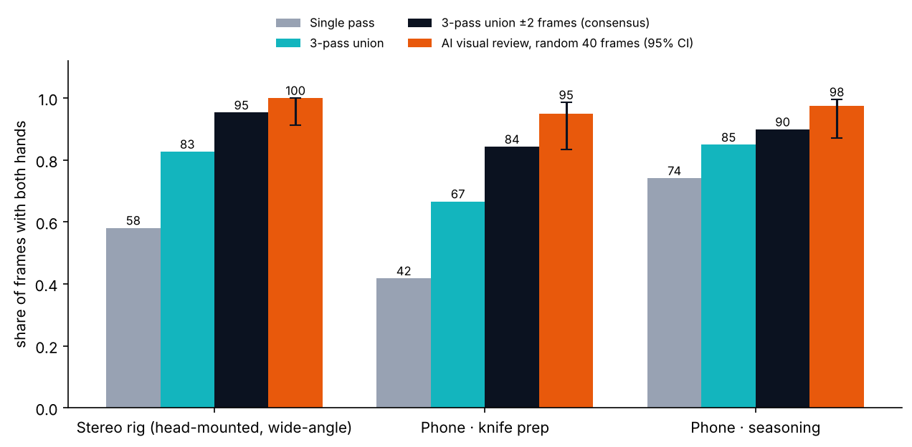
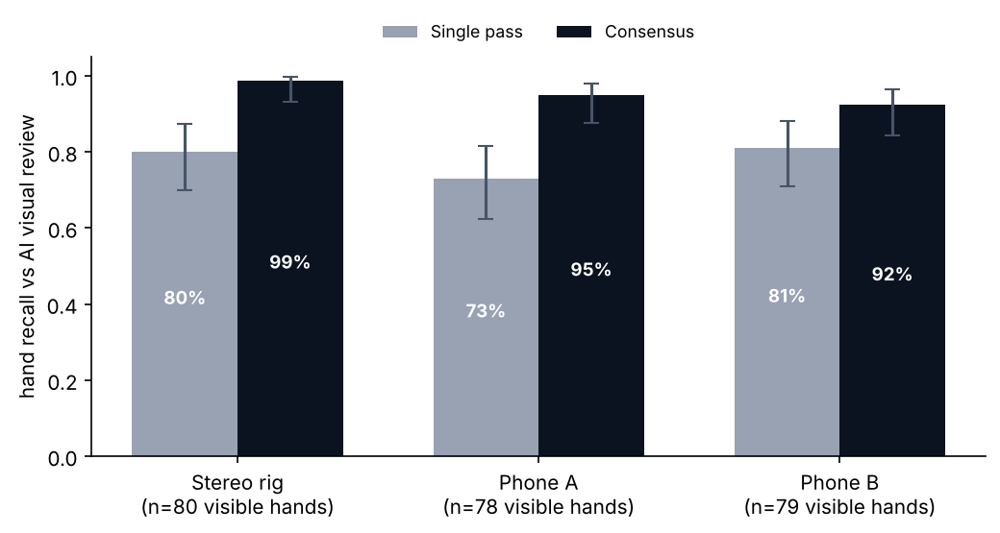
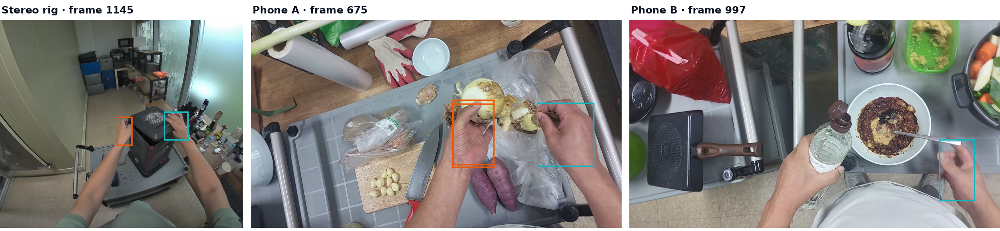
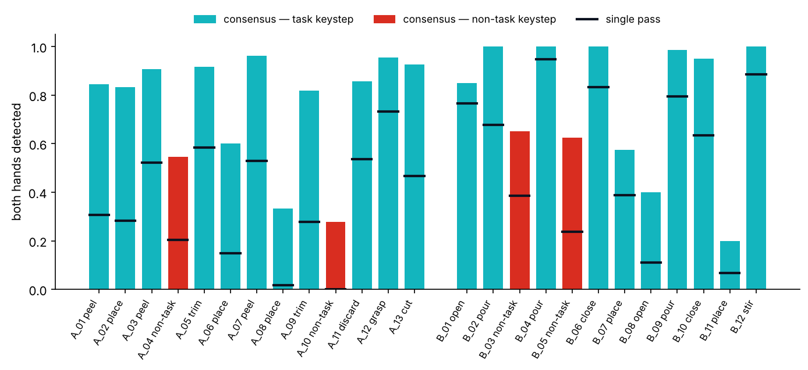
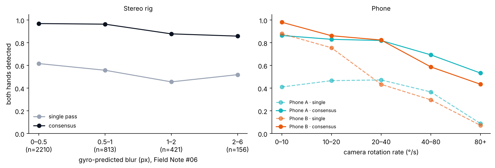
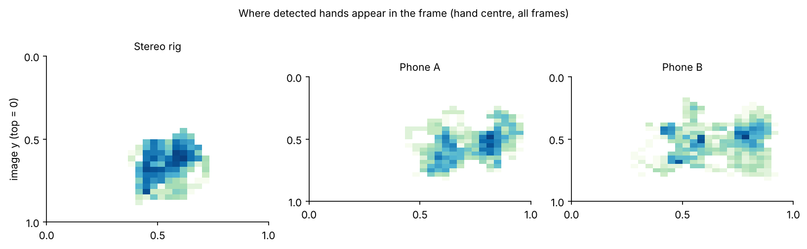

<div align="center">

# Origin Data Lab · Technical Field Note #07

**Evidence-led real-world data production · Egocentric / Physical AI**

[](https://origindatalab.io/technical-field-notes/egocentric-hand-visibility-evaluation.html) 

[](https://github.com/origin-data-lab/egocentric-hand-visibility-evaluation) [](https://huggingface.co/datasets/origin-data-lab/egocentric-hand-visibility-evaluation) [](https://www.kaggle.com/datasets/origindatalab/egocentric-hand-visibility-evaluation) [](https://origindatalab.io/technical-field-notes/egocentric-hand-visibility-evaluation.html)

[English technical note](https://origindatalab.io/technical-field-notes/egocentric-hand-visibility-evaluation.html) · [한국어 기술노트](https://origindatalab.io/ko/technical-field-notes/egocentric-hand-visibility-evaluation.html)

</div>

---

# Egocentric Hand Visibility: Detector Rate vs Reviewed Visibility

Code and per-frame results for **Origin Data Lab Technical Field Note #07** — *Are Both Hands in View? Measuring Hand Visibility in Egocentric Capture*.

> **Status: AI-only preliminary.** Hand detections come from MediaPipe Hands. Review labels come from an AI visual review (multimodal model), not from people. No human verification has been performed. No number here is a certified hand-visibility rate.

## What is here
| Path | Contents |
|---|---|
| `data/hand_visibility_frames.csv` | One row per frame for 7,557 frames from three recordings: three detector passes, consensus, hand position, motion |
| `data/ai_review_labels.csv` | 120 randomly sampled frames (40 per recording) with per-hand states F / C / N from the AI visual review |
| `data/recording_summary.csv`, `data/keystep_summary.csv` | Aggregated results |
| `code/detect_hands.py` | Runs the three MediaPipe passes on a video chunk (needs the source video, which is not public) |
| `code/build_frame_table.py` | Converts raw detections into the per-frame table |
| `code/analyze_hand_visibility.py` | Reproduces every number in the field note from the CSV files |
| `hand_visibility_analysis.ipynb` | Notebook: loading, quality checks, analysis, figures |
| `docs/METHODOLOGY.md` | Definitions, methods, sampling plan, limitations |
| `figures/` | Figures used in the field note |

## Key results (AI-only preliminary)
| Recording | Frames | Single pass | 3-pass union | Consensus (±2 frames) | AI visual review (both visible) |
|---|---:|---:|---:|---:|---:|
| stereo_rig_left | 3,600 | 58.1% | 82.7% | 95.3% | 40/40 |
| phone_knife_prep | 1,979 | 41.8% | 66.6% | 84.3% | 38/40 |
| phone_seasoning | 1,978 | 74.1% | 84.9% | 89.9% | 39/40 |

| Recording | Visible hands reviewed | Single-pass recall | Consensus recall |
|---|---:|---:|---:|
| stereo_rig_left | 80 | 80.0% | 98.8% |
| phone_knife_prep | 78 | 73.1% | 94.9% |
| phone_seasoning | 79 | 81.0% | 92.4% |

## Reproduce
```bash
pip install -r requirements.txt
python code/analyze_hand_visibility.py data/hand_visibility_frames.csv data/ai_review_labels.csv
```
Expected output matches the tables above. Re-running detection requires the source videos, which are not distributed.

Environment used: Python 3.11 (detection) / 3.13 (analysis), MediaPipe 0.10.14, OpenCV 5.0, NumPy 2.5, pandas 3.0, statsmodels 0.15, FFmpeg 6.1; 2-core CPU, no GPU.

## Data not included
Source videos, raw sensor files, camera calibration and any customer material. The tables contain no images, faces, audio or personal identifiers.

## License
**License: not yet applied.** Proposed: CC BY 4.0 for the data files and documentation, MIT for the code. The license will be applied after data-rights, privacy and third-party restrictions are confirmed.

## Citation
```bibtex
@misc{origindatalab2026fieldnote07,
  author       = {{Origin Data Lab}},
  title        = {Are Both Hands in View? Measuring Hand Visibility in Egocentric Capture},
  howpublished = {Technical Field Note \#07},
  year         = {2026},
  url          = {https://origindatalab.io/technical-field-notes/egocentric-hand-visibility-evaluation.html}
}
```

## Visual evidence

These plots are supporting figures from the released evaluation. They do not constitute human-verified ground truth.

### Both hands rate by method



### Detector recall



### Single pass vs consensus examples



### Both hands by keystep



### Detection vs motion



### Hand position heatmap




---

[](https://github.com/origin-data-lab/egocentric-hand-visibility-evaluation) [](https://huggingface.co/datasets/origin-data-lab/egocentric-hand-visibility-evaluation) [](https://www.kaggle.com/datasets/origindatalab/egocentric-hand-visibility-evaluation) [](https://origindatalab.io/technical-field-notes/egocentric-hand-visibility-evaluation.html)
